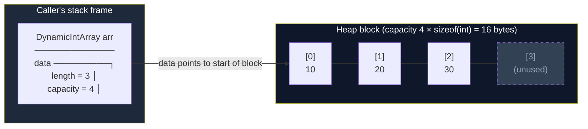
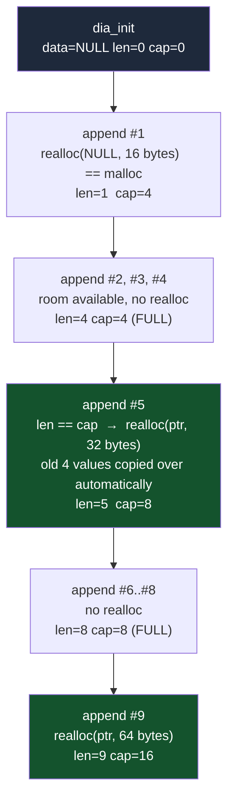
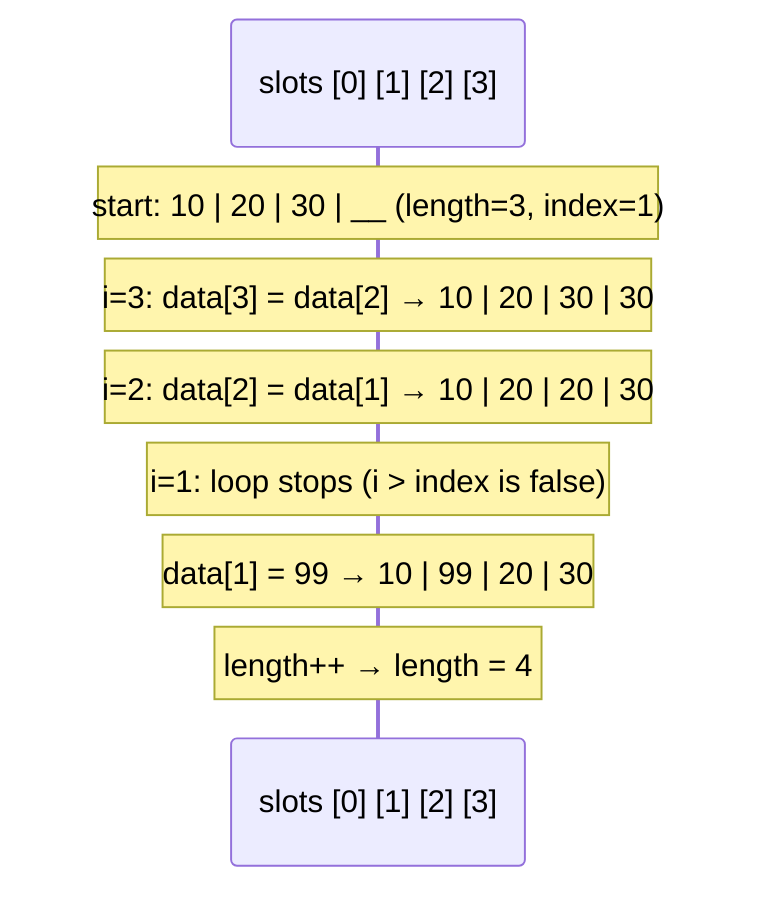
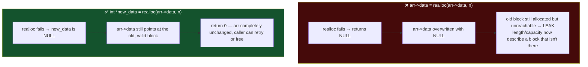
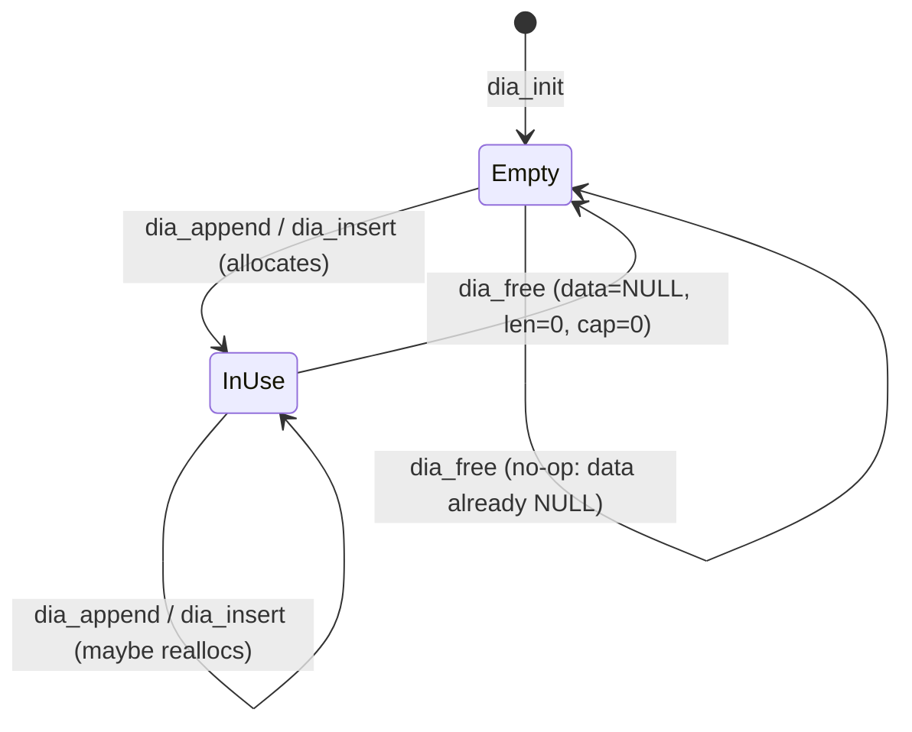

# Dynamic Int Array

**Date:** 2026-09-09
**Language:** C
**Source:** boot.dev
**Concepts:** heap allocation, `malloc`/`realloc`/`free`, length vs. capacity, geometric (doubling) growth, shifting elements, failure-safe `realloc`

---

## 🎯 The Problem

You're building a small game engine in C and need a flexible way to store a list of integer IDs (players, enemies, items). A normal C array has a fixed size, so you build a **dynamic array** that grows when needed.

```c
typedef struct {
  int   *data;     // pointer to the heap-allocated elements
  size_t length;   // how many elements are used
  size_t capacity; // how many elements fit in the allocated block
} DynamicIntArray;

void dia_init(DynamicIntArray *arr);
int  dia_append(DynamicIntArray *arr, int value);
int  dia_insert(DynamicIntArray *arr, size_t index, int value);
void dia_free(DynamicIntArray *arr);
```

**`dia_init`** — `data` is `NULL`, `length` and `capacity` are both `0`.

**`dia_append`** — append `value` at the end. Grow first if needed (capacity `0` → `4`, otherwise double). Return `1` on success, `0` if allocation fails, and **do not modify `length` or `capacity` on failure**.

**`dia_insert`** — insert `value` at `index` (valid range `0..length` inclusive; `index == length` behaves like append). If `index > length`, do nothing and return `0`. Grow the same way as append. Shift everything at and after `index` one step right, then write the value. Return `1` on success, `0` on a bad index or allocation failure.

**`dia_free`** — `free` the block if `data` isn't `NULL`, then set `data = NULL`, `length = 0`, `capacity = 0`, so the struct can be reused or freed again without a double-free.

```c
DynamicIntArray ids;
dia_init(&ids);
dia_append(&ids, 10);  dia_append(&ids, 20);  dia_append(&ids, 30);
dia_insert(&ids, 0, 5);    // [5, 10, 20, 30]
dia_insert(&ids, 2, 99);   // [5, 10, 99, 20, 30]
dia_free(&ids);
```

**Tips from the task:** `malloc` for the first allocation and `realloc` to expand; only update `data`/`capacity`/`length` *after* allocation succeeds; when shifting for insert, start from the end and move backwards so you don't overwrite values you still need.

---

## 🧩 My Thought Process

Everything hangs on keeping two numbers straight: `length` (how many slots hold real data) and `capacity` (how many slots the heap block can hold). The invariant is always `length <= capacity`, and `data` is `NULL` exactly when `capacity == 0`.

**`dia_init`** just establishes that invariant in its simplest form: no block, nothing used.

**Growth (shared by append and insert).** When `length == capacity`, there's no room. The new capacity is `4` if we've never allocated, otherwise double. Doubling matters: growing by a fixed amount (say +1 or +4) would make n appends cost O(n²) total because every grow copies everything; doubling makes the copying cost amortized O(1) per append.

I call `realloc` rather than `malloc` + copy, because `realloc(NULL, n)` behaves exactly like `malloc(n)`. That means one code path handles both "first allocation" (`data == NULL`) and "grow an existing block" — no `if (data == NULL) malloc else realloc` branch.

The key safety move is **not** writing `arr->data = realloc(arr->data, ...)` directly. If `realloc` fails it returns `NULL` and leaves the *old* block untouched — but assigning that `NULL` straight into `arr->data` would throw away the only pointer to it (a leak) and leave `length`/`capacity` lying about a block that no longer exists. So the result goes into a temporary `new_data` first, and `arr->data` / `arr->capacity` are only updated once I know it's non-`NULL`:

```c
int *new_data = realloc(arr->data, new_capacity * sizeof(int));
if (new_data == NULL) {
  return 0;            // arr is exactly as it was
}
arr->data = new_data;
arr->capacity = new_capacity;
```

**`dia_append`** — grow if full, then `arr->data[arr->length] = value; arr->length++`. The write happens strictly *after* the capacity check, so `data[length]` is always a valid slot.

**`dia_insert`** — check the index first (`index > length` → return `0` before touching anything), grow if full, then shift. The shift loop runs **backwards** from the first free slot:

```c
for (size_t i = arr->length; i > index; i--) {
  arr->data[i] = arr->data[i-1];
}
```

Going forwards would copy `data[index]` into `data[index+1]`, then copy that (already overwritten) value into `data[index+2]`, smearing one value across the rest. Going backwards, each destination slot has already been vacated by the previous step. Using `i > index` with `size_t` (unsigned) also avoids a trap: a loop like `for (size_t i = length - 1; i >= index; i--)` would wrap around when `index == 0`, because an unsigned `i >= 0` is always true.

**`dia_free`** — `free` the single block, then reset all three fields. Only one `free` is needed because `data` is *one* allocation holding `int`s by value — there's no per-element allocation to walk and free. (The commented-out `// This is wrong` loop in my solution is the instinct from arrays of heap pointers like `char *names[]`; here the elements aren't pointers, so freeing `arr->data[i]` would pass an `int` to `free`.) Resetting to `NULL`/`0` afterwards makes a second `dia_free` a harmless no-op and lets the struct be reused.

---

## ✅ My Solution

```c
#include <stdlib.h>
#include <stddef.h>

#include "exercise.h"

void dia_init(DynamicIntArray *arr) {
    if (arr == NULL) {
      return;
    }
    arr->data = NULL;
    arr->length = 0;
    arr-> capacity = 0;
}

int dia_append(DynamicIntArray *arr, int value) {

  if (arr->length == arr->capacity) {
    size_t new_capacity;

    if (arr->capacity == 0) {
      new_capacity = 4;
    } else {
      new_capacity = arr->capacity * 2;
    }

    int *new_data = realloc(arr->data, new_capacity * sizeof(int));

    if (new_data == NULL) {
      return 0;
    }

    arr->data = new_data;
    arr->capacity = new_capacity;
  }
  
  arr->data[arr->length] = value;
  arr->length++;
  return 1;
}

int dia_insert(DynamicIntArray *arr, size_t index, int value) {
  if (index > arr->length) {
    return 0;
  }

  if (arr->length == arr->capacity) {
    size_t new_capacity;

    if (arr->capacity == 0) {
      new_capacity = 4;
    } else {
      new_capacity = arr->capacity * 2;
    }

    int *new_data = realloc(arr->data, new_capacity * sizeof(int));

    if (new_data == NULL) {
      return 0;
    }

    arr->data = new_data;
    arr->capacity = new_capacity;
  }

  for (size_t i = arr->length; i > index; i--) {
    arr->data[i] = arr->data[i-1];
  }

  arr->data[index] = value;
  arr->length++;
  return 1;
}

void dia_free(DynamicIntArray *arr) {
  if (arr->data != NULL) {
    // This is wrong
    // for (int i=0; i < arr->length; i++) {
    //   free(arr->data[i]);
    // }
      free(arr->data);
    }
  arr->data = NULL;
  arr->length = 0;
  arr->capacity = 0;
}
```

---

## 🖼️ Visualizing the Dynamic Array

### 1. Stack header, heap block: where the pieces live

The `DynamicIntArray` struct itself is tiny and (in the tests) lives on the stack. The actual elements live in a separate heap block that `data` points at. `capacity` describes the block; `length` describes how much of it is in use.



Slots `[0]..[length-1]` hold real values; slots `[length]..[capacity-1]` are allocated but unused ("spare room"). That spare room is what makes most appends free.

### 2. Growth: capacity 0 → 4 → 8 → 16



Only appends #1, #5, and #9 trigger a `realloc`; the rest are a single write. `realloc` may move the block to a new address, which is exactly why the code always re-reads `arr->data` afterwards and never holds on to an old element pointer across an append.

### 3. `dia_insert(&arr, 1, 99)` on `[10, 20, 30]`: shifting backwards

Each step copies one value one slot to the right, moving from the end toward the insertion point. By the time a slot is overwritten, its old value has already been copied out.



**What a forward loop would have done instead:** `data[2] = data[1]` → `10 | 20 | 20 | __`, then `data[3] = data[2]` → `10 | 20 | 20 | 20`. The `30` is gone, overwritten before it was ever copied. Moving backwards is what makes the shift lossless.

### 4. Why `realloc` goes into a temporary pointer first



The task says "do not modify `length` or `capacity` on failure." The temp-pointer pattern is what actually delivers that guarantee (and it also keeps the old data intact, which the task implies but doesn't spell out).

### 5. Lifecycle of the struct across `dia_free`



`dia_free` returns the struct to *exactly* the state `dia_init` produces, which is why freeing twice is safe and why the same variable can immediately be appended to again.

---

## ✅ Verification

I built a dependency-free C harness (`verify_dynamic_array.c`) that reproduces all four `munit_case` blocks from the pasted `main.c`, using `CHECK_INT` / `CHECK_SIZE` / `CHECK_TRUE` / `CHECK_PTR_NULL` macros in place of munit's `assert_size`, `assert_int`, and `assert_ptr_null`.

Beyond the original suite I added six extra tests, because the original only ever grows to capacity 8 and never inspects capacity values:

- **init state** — `dia_init` overwrites garbage `data`/`length`/`capacity`.
- **capacity growth sequence** — asserts the exact capacities `4 → 8 → 16` at the exact append counts (the original tests only check `capacity >= length`).
- **insert triggers growth** — insert into a brand-new empty array, and insert at index 0 of a *full* array (growth and shift in the same call).
- **invalid insert leaves state alone** — `data` pointer, `length`, and `capacity` all untouched when `index > length`.
- **free is reusable and double-free safe** — free twice, then append again on the same struct; free on an init-only array.
- **large growth** — 1000 appends (about 8 reallocs), every value intact, final capacity 1024.

**Allocation failure.** The requirement "return `0` and don't modify `length`/`capacity` if allocation fails" can't be triggered by normal tests, so a second file, `verify_alloc_failure.c`, forces `realloc` to fail on demand using the linker's `--wrap` option. It checks that a failed first allocation leaves the array empty, that a failed *growth* leaves the old data pointer and every old element intact (no corruption, no leak), that a failed insert doesn't shift anything, and that the array works normally afterwards.

```bash
# Main suite: plain build
gcc -std=c99 -Wall -Wextra -o verify_plain exercise.c verify_dynamic_array.c
./verify_plain

# Main suite: AddressSanitizer + UndefinedBehaviorSanitizer (also reports leaks)
gcc -std=c99 -Wall -Wextra -fsanitize=address,undefined -g -o verify_asan exercise.c verify_dynamic_array.c
./verify_asan

# Allocation-failure injection (plain, then sanitized)
gcc -std=c99 -Wall -Wextra -Wl,--wrap=realloc -o verify_fail exercise.c verify_alloc_failure.c
./verify_fail
gcc -std=c99 -Wall -Wextra -fsanitize=address,undefined -g -Wl,--wrap=realloc -o verify_fail_asan exercise.c verify_alloc_failure.c
./verify_fail_asan
```

**Real output:**

```
Running checks for dia_init / dia_append / dia_insert / dia_free

  test_dia_run_basic_append
  test_dia_run_insert_middle
  test_dia_submit_grow_and_order
  test_dia_submit_inserts_edges_and_free

  -- extra checks --
  test_extra_init_state
  test_extra_capacity_growth_sequence
  test_extra_insert_triggers_growth
  test_extra_invalid_insert_leaves_state_alone
  test_extra_free_is_reusable_and_double_free_safe
  test_extra_large_growth

67/67 checks passed
```

```
Running allocation-failure checks

14/14 checks passed
```

Both suites pass on the plain build **and** under ASan+UBSan, with zero compiler warnings on `exercise.c`. Because ASan includes LeakSanitizer, "no leak reported" is a real result here, not an assumption: every block allocated across 1000-element growth, double-free attempts, and the simulated failures was released exactly once.

---

## 🔍 Portions Worth Refactoring

The solution is correct and warning-free. These are design observations, not bugs:

1. **The growth block is copy-pasted between `dia_append` and `dia_insert`** (about 15 identical lines). Any future tweak (a different growth factor, say) has to be made in two places, and the two copies can silently drift apart. Pulling it into one `static int dia_ensure_room(DynamicIntArray *arr)` helper removes the duplication. Even further, `dia_append` is just `dia_insert(arr, arr->length, value)`, since `index == length` is exactly "insert at the end", so it can collapse to one line.

2. **`dia_append`, `dia_insert`, and `dia_free` don't NULL-check `arr`, but `dia_init` does.** Passing `NULL` to `dia_append` dereferences it immediately. The task never passes `NULL`, so this is a robustness choice rather than a defect, but the inconsistency is visible within the one file.

3. **`new_capacity * sizeof(int)` is not overflow-checked.** On a 64-bit machine you'd run out of memory long before `capacity * 2` wrapped, so it's theoretical, but a one-line guard (`new_capacity > SIZE_MAX / sizeof(int)`) makes the failure path explicit. A defensive habit worth having for any size computation fed to an allocator.

4. **Cosmetic:** `arr-> capacity` (stray space) in `dia_init`, `dia_free`'s closing brace indentation, and the leftover `// This is wrong` commented-out loop. That comment is a useful note-to-self while learning, but would normally be deleted before committing.

I tried the first three together as a refactor (a shared `dia_ensure_room` helper, `dia_append` delegating to `dia_insert`, NULL checks, and the overflow guard) and it passed the same 67 checks and 14 failure-injection checks under ASan+UBSan with zero warnings, so the duplication really is only a style cost, not something the behavior depends on. I left the submitted code untouched in this write-up.

---

## 💡 The Core Lesson

A dynamic array is a fixed-size heap block plus the discipline to keep three fields honest: **`data`** points at the block, **`capacity`** says how big the block is, **`length`** says how much is in use. Every function's job is to leave those three consistent, including on failure. The two places that discipline gets tested are `realloc` (use a temporary, only commit `data`/`capacity` on success) and the insert shift (move backwards, so nothing is overwritten before it's copied).

---

## 📚 Lessons Learnt

1. **`length` and `capacity` are different quantities.** Capacity is how much room exists; length is how much is used. Mixing them up is the classic off-by-one source: writing at `data[capacity]`, or growing when `length < capacity`.

2. **Never assign `realloc`'s return value straight back to the pointer you passed in.** On failure it returns `NULL` while the original block is still alive; overwriting your only pointer leaks it. Use a temporary and commit only on success.

3. **`realloc(NULL, n)` is `malloc(n)`.** That's why one `realloc` call handles both the first allocation and every later growth, with no separate branch.

4. **Doubling gives amortized O(1) appends.** Each grow copies everything, but grows get exponentially rarer (appends #1, #5, #9, #17, ...), so the total copying over n appends is O(n), not O(n²).

5. **Shift backwards when opening a gap, forwards when closing one.** Moving elements right (insert) must start from the end; going forwards overwrites values before they're copied. The mirror case (delete, moving left) goes forwards.

6. **Unsigned loop counters need `i > index`, not `i >= index` with a decrementing `i`.** `size_t i >= 0` is always true, so a downward loop to index `0` never terminates correctly. Writing the condition as `i > index` and reading from `i-1` sidesteps this entirely.

7. **`free` takes the pointer `malloc`/`realloc` returned, once.** A `DynamicIntArray` owns one block of `int`s by value, so there's no per-element `free`. The loop I wrote and then crossed out was the right instinct for an array of *pointers*, but not for an array of ints.

8. **Reset the struct after `free`.** Setting `data = NULL`, `length = 0`, `capacity = 0` makes a second `dia_free` a harmless no-op and puts the struct back into the same state `dia_init` produces, so it's safe to reuse.

9. **"Fails safely" needs a test that makes it fail.** The normal test suite can't prove the allocation-failure requirement because `malloc` essentially never fails there. Injecting a failing `realloc` (via `--wrap`) turned a claim I'd only reasoned about into something I actually ran.

---

## 🔗 Further Reading

- [cppreference: `realloc`](https://en.cppreference.com/w/c/memory/realloc), especially the section on what happens to the original block on failure
- [cppreference: `malloc`](https://en.cppreference.com/w/c/memory/malloc) and [`free`](https://en.cppreference.com/w/c/memory/free)
- [GNU ld `--wrap` option](https://sourceware.org/binutils/docs/ld/Options.html), the mechanism used for failure injection
- [AddressSanitizer / LeakSanitizer](https://github.com/google/sanitizers/wiki/AddressSanitizerLeakSanitizer)
- **Suggested next exploration:** add `dia_remove(arr, index)` (shift left, forwards this time) and `dia_shrink_to_fit` (a `realloc` that *shrinks*), then check that the invariant `length <= capacity` and the failure-safety property still hold for both.

---

**Repo path:** `c/2026-10-10-dynamic-int-array/`