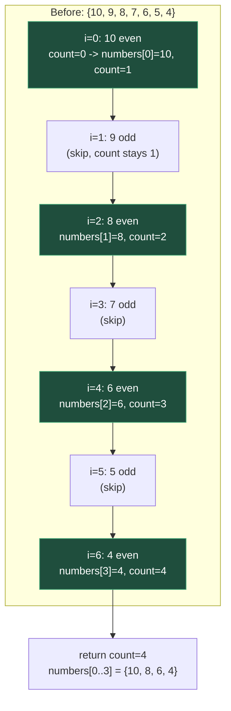
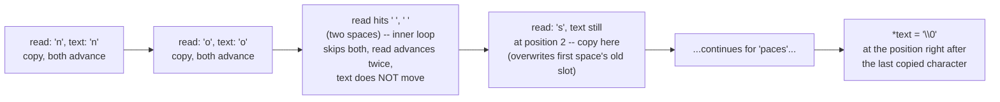

# Filter With Pointers

**Date:** 2026-09-13

**Language:** C

**Source:** boot.dev

**Concepts:** read/write index pair (slow-fast pointer pattern) · in-place array compaction with no new allocation · in-place string compaction via two `char*` cursors · preserving relative order while filtering · manual null-termination

---

## 🎯 The Problem

You're cleaning up some game data stored in arrays. Complete two functions, both required to work **in-place** — no new arrays, no allocation:

### 1. `filter_even(int *numbers, int length)`

Modify the array in-place so that:

- All **even** numbers are moved to the **front** of the array.
- The **order** of the even numbers stays the same as in the original array.
- You don't need to keep anything specific in the elements after the last even number.
- Return the **count** of even numbers.

```c
int nums[7] = {10, 9, 8, 7, 6, 5, 4};
int count = filter_even(nums, 7);
// count == 4
// nums starts with the even numbers, in order: nums[0..3] == {10, 8, 6, 4}
// elements after index 3 can be anything
```

### 2. `squeeze_spaces(char *text)`

`text` is a C string. Change it **in-place** to remove all space characters (`' '`):

- Keep all non-space characters in the same relative order.
- Remember to keep the final `'\0'` string terminator at the end.

```c
char name[] = "  The  Dragon King  ";
squeeze_spaces(name);
// name is now: "TheDragonKing"
```

### Requirements

- Do **not** allocate new memory — modify the given array/string directly.
- Do **not** print inside these functions.
- Either array indexing or pointer arithmetic is fine, but the challenge is about pointers, so prefer thinking in terms of pointer movement.

### Hints given

Think in terms of two positions: where you're **reading from**, and where you're **writing to**. You can move these with indexes or by moving a pointer forward.

---

## 🧩 My Thought Process

Both functions are the same underlying pattern applied to two different data types: a **read cursor** that scans every element, and a **write cursor** that only advances when something needs to be kept. The write cursor never gets ahead of the read cursor, so writing through it is always safe — it's either writing to a position the read cursor has already passed (overwriting data that's already been read and doesn't need to be kept), or writing to its own current position (a harmless no-op write).

**`filter_even` — index pair, `count` doing double duty as the write position.**

```c
int count = 0;
for (int i = 0; i < length; i++) {
    if (numbers[i] % 2 == 0) {
        numbers[count] = numbers[i];
        count++;
    }
}
return count;
```

`i` is the read position — it visits every element exactly once, regardless of whether it's even or odd. `count` is the write position — it only advances when an even number was just written. Because `count` only ever increases when a value is kept, and `i` always increases every iteration, `count <= i` holds at every point in the loop: the write position never runs ahead of the read position, so `numbers[count] = numbers[i]` is always either writing a value into its own current slot (when no odds have been skipped yet) or overwriting an already-read, already-decided-to-discard slot further back. That's what makes the in-place compaction safe — the required final step ("elements after the last even number can be anything") is a consequence of this scheme, not something the function has to fix up separately. `count` conveniently *is* the answer the function needs to return — the number of even values, which equals the final write position.

**`squeeze_spaces` — two `char*` cursors walking through the same string.**

```c
void squeeze_spaces(char *text) {
  char *read = text;

  while (*read != '\0') {
    while (*read == ' ') {
      read++;
    }
    if (*read != '\0') {
      *text = *read;
      text++;
      read++;
    }
  }
  *text = '\0';
}
```

This is the same read/write-cursor idea as `filter_even`, just with `text` itself doing the writing (instead of a separate index) and `read` doing the reading. The inner `while (*read == ' ') read++;` is what actually implements "skip spaces" — it can consume any number of consecutive spaces (one, two, or more) before the outer logic resumes, which is exactly what's needed for the `"no  spaces"` → `"nospaces"` case with a double space.

After skipping spaces, `if (*read != '\0')` guards the copy: if skipping spaces walked `read` all the way to the end of the string (trailing spaces), there's nothing left to copy, and the outer `while` loop's own condition catches that and exits. Only when there's an actual non-space character left does `*text = *read;` copy it, advancing both cursors together by one.

The final `*text = '\0';` after the loop is what actually terminates the squeezed string — `text` has been advancing only on real (non-space) characters copied, so by the time the loop ends, `text` sits exactly one past the last kept character, which is precisely where the new terminator belongs.

---

## ✅ My Solution

```c
int filter_even(int *numbers, int length) {
  int count = 0;

  for (int i = 0; i < length; i++) {
    if (numbers[i] % 2 == 0) {
      numbers[count]= numbers[i];
      count++;
    }
  }
  return count;
}

void squeeze_spaces(char *text) {
  char *read = text;

  while (*read != '\0') {
    while (*read == ' ') {
      read++;
    }
    if (*read != '\0') {
      *text = *read;
      text++;
      read++; 
    }

  }
  *text = '\0';  
}
```

---

## 🖼️ Visualizing the Read/Write Cursor Pattern

For `filter_even({10, 9, 8, 7, 6, 5, 4}, 7)`:



Notice `i` (read) always advances by exactly one per step, while `count` (write) only advances on the green steps — this gap between how often each cursor moves is exactly what compacts the evens toward the front while preserving their original relative order.

### `squeeze_spaces` on `"no  spaces"`



The key moment is `s2` → `s3`: `read` jumps ahead by two positions while skipping the double space, but `text` stays put — so when the next real character (`'s'`) is found, it gets written into the slot right after `"no"`, closing the gap left by the skipped spaces.

---

## ✅ Verification — Plain C, No External Test Library

Following the standard established for C exercises in this repo, I reproduced all six cases from the pasted `munit`-based test file as a dependency-free plain-C file, using the `CHECK_INT`/`CHECK_STR` macro pattern:

```c
#include <stdio.h>
#include <string.h>

int filter_even(int *numbers, int length);
void squeeze_spaces(char *text);

static int tests_run = 0;
static int tests_passed = 0;

#define CHECK_INT(actual, expected, msg)  /* ... */
#define CHECK_STR(actual, expected, msg)  /* ... */

void test_filter_even_run_basic(void) {
    int nums[5] = {1, 2, 3, 4, 5};
    int result = filter_even(nums, 5);
    CHECK_INT(result, 2, "even count");
    CHECK_INT(nums[0], 2, "nums[0]");
    CHECK_INT(nums[1], 4, "nums[1]");
}
/* ...five more test functions, same pattern, covering all-even input,
   simple and double-space squeezing, zero/no-match edges, a larger
   happy-path array, and leading/trailing/multi-inner spaces plus an
   empty string... */

int main(void) {
    test_filter_even_run_basic();
    test_filter_even_run_all_even();
    test_squeeze_spaces_run_simple();
    test_filter_even_submit_edges();
    test_filter_even_submit_big_happy();
    test_squeeze_spaces_submit();
    printf("\n%d/%d checks passed\n", tests_passed, tests_run);
    return (tests_passed == tests_run) ? 0 : 1;
}
```

One thing worth noting from the verification process itself: my first version of the `CHECK_STR` macro triggered a `-Waddress` warning ("the address of 'text1' will always evaluate as 'true'") when called on a fixed-size local array like `char text1[] = "hello world";` — the compiler can prove a named array's address is never `NULL`, so the macro's `actual ? actual : "(null)"` null-check read as always-true for that call site. I fixed this by assigning `actual` into a local `const char *` variable first inside the macro, so the null-check happens on a genuine pointer value rather than directly on an array expression. This was a bug in my *test harness*, not in `squeeze_spaces` itself.

Compiled and run two ways — a plain build, and a second build under **AddressSanitizer + UndefinedBehaviorSanitizer**, specifically because both functions do in-place, cursor-driven writes with no allocation, which is exactly where a write-cursor-ahead-of-read-cursor bug would show up as corrupted or out-of-bounds data:

```bash
gcc -std=c99 -Wall -Wextra -o verify_plain exercise.c verify_filter_pointers.c
./verify_plain

gcc -std=c99 -Wall -Wextra -fsanitize=address,undefined -g -o verify_asan exercise.c verify_filter_pointers.c
./verify_asan
```

**Result (both builds, identical, zero warnings from either `exercise.c` or the corrected verification file):**

```
Running checks for filter_even / squeeze_spaces

  test_filter_even_run_basic
  test_filter_even_run_all_even
  test_squeeze_spaces_run_simple
  test_filter_even_submit_edges
  test_filter_even_submit_big_happy
  test_squeeze_spaces_submit

18/18 checks passed
```

Both exit `0`. The ASan/UBSan build confirms both functions read and write strictly within their given array/string bounds across every scenario tested, including a zero-length array, an all-odd array (nothing ever written past index 0 conceptually), an empty string, and a string with leading, trailing, and multiple consecutive inner spaces.

---

## 🔍 Portions Worth Refactoring

**1. `filter_even` and `squeeze_spaces` are the same algorithmic pattern (read cursor + conditionally-advancing write cursor) applied to two different data types — not worth merging, but worth recognizing as one idea.**

`int count` plus array indexing in one function, and a dedicated `char *text` cursor in the other, are structurally the same technique: scan everything once, keep what passes a test, and let the write position only move when something is actually kept. C's type system makes a single generic version awkward to write cleanly (one works over `int[]`, the other over `char*`), so two separate, similarly-shaped functions is the right level of abstraction here — but it's worth naming the shared pattern explicitly, since recognizing "this is a read/write cursor problem" is what makes both functions straightforward to write correctly in the first place.

**2. No performance concern.**

Both functions are O(n) — a single linear pass over the array or string, which is the minimum possible work needed to examine every element/character once. Neither does any nested scanning or repeated work.

**3. `squeeze_spaces`'s inner `while (*read == ' ') { read++; }` only recognizes a literal space — worth knowing the boundary of what counts as whitespace here.**

The task specifically asks to remove `' '` characters, not all whitespace (tabs, newlines, etc.), so this is correct as scoped. If a future version of this task extended "whitespace" to include other characters, the fix would be changing this one condition (e.g., to `isspace((unsigned char)*read)` from `<ctype.h>`) without touching the surrounding cursor logic at all — the read/write cursor structure is independent of exactly which characters get skipped.

---

## 💡 The Core Lesson

**In-place filtering and compaction — whether on an `int` array or a C string — comes down to one idea: let a read cursor examine every element unconditionally, and let a write cursor advance only when something is worth keeping. Because the write cursor can never get ahead of the read cursor, every write is always either harmless (writing a value into its own current slot) or a safe overwrite of data that's already been read and decided not to keep.**

This is why neither function needs a second array or any allocation: the "gap" left behind by skipped elements (odd numbers, space characters) is naturally closed by the write cursor simply not moving while the read cursor continues forward — there's no extra bookkeeping needed to "shift everything left," because the write cursor already *is* positioned exactly where the next kept value belongs.

---

## 📚 Lessons Learnt

**1. A read cursor and a write cursor moving at independent rates is the general technique behind in-place compaction.**
The read cursor visits every element exactly once; the write cursor only advances on a "keep this" decision — the two never need to be the same variable, and keeping them conceptually separate (even when one is implemented as a plain index like `count`) is what makes the logic easy to reason about.

**2. The write cursor can never get ahead of the read cursor, which is exactly what makes in-place writes safe.**
Since the write position only increases on a subset of the steps the read position increases on, `write <= read` is an invariant that holds throughout the whole scan — meaning every write either lands on a not-yet-finally-decided slot or overwrites data that's already been fully read and is safe to discard.

**3. "Order is preserved" falls out of scanning left-to-right with a monotonically-advancing write cursor — it isn't something that needs separate handling.**
Both functions process elements strictly in their original order and only ever move the write cursor forward, never backward or out of sequence — so the relative order of kept elements is automatically preserved as a consequence of the scan direction, not an extra feature bolted on.

**4. An inner loop that skips a *run* of unwanted elements (not just one) is what correctly handles consecutive duplicates.**
`while (*read == ' ') { read++; }` consumes any number of consecutive spaces before the outer logic resumes — this is specifically what makes `"no  spaces"` (a double space) squeeze correctly to `"nospaces"` rather than leaving a single leftover space behind.

**5. The terminator (or "nothing to keep after this point" marker) has to be written explicitly after the loop, based on wherever the write cursor ended up.**
`*text = '\0';` only works correctly because `text` has been tracking the actual write position the whole time — it isn't computed separately or guessed at, it's just wherever the cursor naturally stopped.

**6. A compiler warning in test-harness code is still worth fixing, even though it's not the code under test.**
The `-Waddress` warning on `CHECK_STR(text1, ...)` was entirely in my own verification macro, not in `squeeze_spaces` — but leaving a warning in place (even a harmless one) makes it harder to trust that "zero warnings" actually means zero warnings the next time the verification file is extended.

**7. AddressSanitizer is a meaningful check for cursor-pair in-place algorithms specifically because a write-ahead-of-read bug is a real failure mode this pattern is designed to avoid — worth confirming it actually holds, not just assuming the logic is correct.**
A functional pass/fail count confirms the final array or string came out right. Running the same binary under `-fsanitize=address` is what actually confirms every read and write stayed within bounds across all six scenarios, including the edge cases most likely to expose a cursor-ordering mistake (zero length, all-match, no-match, and multiple consecutive skips).

---

## 🔗 Further Reading

- [cppreference — Erase-remove idiom (C++, same underlying technique)](https://en.cppreference.com/w/cpp/algorithm/remove) — the standard-library version of exactly this read/write cursor pattern, generalized via iterators
- [cppreference — `isspace`](https://en.cppreference.com/w/c/string/byte/isspace) (relevant if "remove whitespace" is ever generalized beyond just `' '`)
- [AddressSanitizer (Google/LLVM)](https://github.com/google/sanitizers/wiki/AddressSanitizer)
- Next to explore: write a `filter_odd` alongside `filter_even` and factor out the shared read/write-cursor loop into a helper that takes a predicate (via a function pointer) — a good test of whether the `int`-array version of this pattern is worth generalizing the way the C-string version already is specific to "skip spaces."