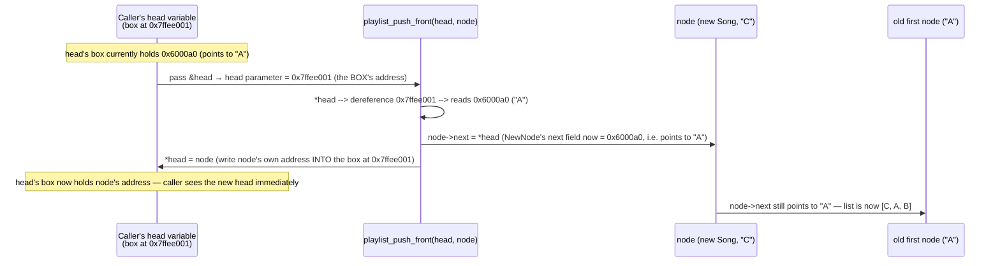
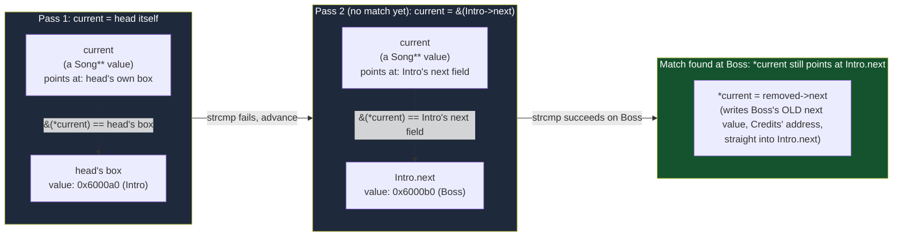
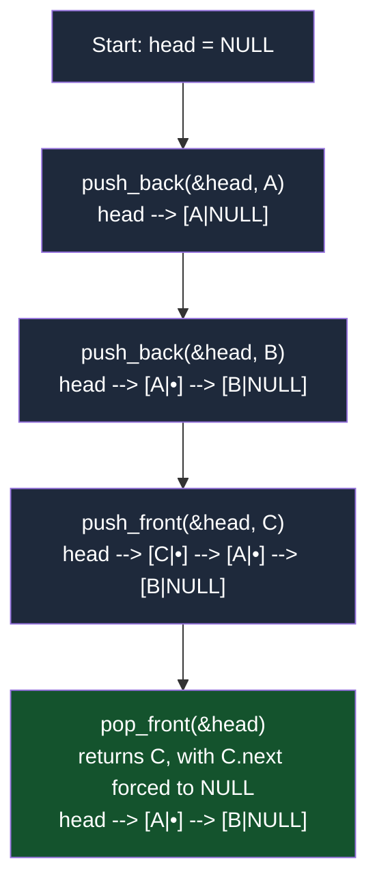

# Implement a Pointer-Based Playlist

**Date:** 2026-09-14
**Language:** C
**Source:** boot.dev
**Concepts:** singly linked lists, pointer-to-pointer (`Song **`), heap allocation/ownership, pointer rewiring without a "previous" pointer

---

## 🎯 The Problem

Build a simple music playlist system using a **singly linked list**. Each song is a `Song` node that lives on the **heap**, and the playlist itself is represented by a pointer to the head node.

The `Song` type and function declarations are provided in `song.h`:

```c
typedef struct Song {
  const char *title;
  struct Song *next;
} Song;

void playlist_push_front(Song **head, Song *node);
void playlist_push_back(Song **head, Song *node);
Song *playlist_pop_front(Song **head);
Song *playlist_find(Song *head, const char *title);
Song *playlist_extract(Song **head, const char *title);
void playlist_clear(Song **head);
```

**Rules:**
- The tests allocate `Song` nodes for you — **do not** allocate new `Song` nodes inside these functions.
- **Do not** free any `Song` nodes inside `push_front`, `push_back`, `pop_front`, `find`, or `extract`. Only `playlist_clear` should call `free` on `Song` nodes.
- Use **pointer manipulation only** to rearrange the nodes.

**Tasks:**

1. **`playlist_push_front(Song **head, Song *node)`** — insert `node` as the new head. If `node` is `NULL`, do nothing. Must correctly handle an empty list (`*head == NULL`).
2. **`playlist_push_back(Song **head, Song *node)`** — append `node` after the last song. If `node` is `NULL`, do nothing. If the list is empty, `node` becomes the head. Must leave `node->next == NULL`.
3. **`playlist_pop_front(Song **head)`** — remove and return the head node. If the list is empty, return `NULL`. Otherwise update `*head` to the next node, set the removed node's `next` to `NULL`, and return it (caller owns it now — do not `free` it here).
4. **`playlist_find(Song *head, const char *title)`** — traverse and return a pointer to the first `Song` whose `title` matches, using `strcmp`, or `NULL` if not found.
5. **`playlist_extract(Song **head, const char *title)`** — find the first node matching `title`, unlink it from the list (fixing pointers so the rest stays connected), set its `next` to `NULL`, and return it. Return `NULL` if not found or the list is empty.
   - *Hint from the task:* a good place to use a **pointer-to-pointer traversal** — keep a `Song **current` that always points to the pointer that leads to the current node (`*current`), so you can rewire links without needing a separate "previous" pointer.
6. **`playlist_clear(Song **head)`** — traverse the list, `free` every node, and set `*head` to `NULL`. Assume `title` pointers either point to string literals or are managed elsewhere — do **not** free the title strings.

---

## 🧩 My Thought Process

The one idea that makes every function in this task work is: **a `Song *` variable *is itself* stored somewhere, and that storage location has its own address.** `head` in `main()` is one such location. `prev->next` inside a node is another. `playlist_push_front`, `pop_front`, and `extract` all need to *modify* whichever of these is currently "the thing pointing at the node I care about" — and a `Song **` is exactly "the address of one of those storage locations."

**`playlist_push_front`** — the new node needs to become the first thing `*head` points to, and the old first node needs to hang off the new node's `next`:

```c
node->next = *head;  // new node points at whatever used to be first
*head = node;         // the caller's head pointer now points at the new node
```

Both lines modify something *through* a pointer: `node->next` writes into the new node (ordinary single-pointer write), but `*head = node` writes into the *caller's* `head` variable — which is only possible because we received `&head` as `Song **head`, not a copy of the pointer.

**`playlist_push_back`** — walk node-by-node until `current->next == NULL` (the last node), then attach the new node there. The empty-list case is separate because there's no "last node" to walk to.

**`playlist_pop_front`** — the mirror image of push_front: save `*head`, advance `*head` to `(*head)->next`, detach the saved node's `next`, return it. The test file's helper also frees what we return, which is why the function itself must never call `free` on it — ownership transfers to the caller.

**`playlist_find`** — the simplest one: no pointer-to-pointer needed because we're only *reading*, never rewiring. A plain `Song *` walk with `strcmp` is enough.

**`playlist_extract`** — this is where `Song **` earns its keep. Instead of tracking a `prev` node and special-casing "what if the match is the head" (where `prev` doesn't exist), I keep a `Song **current` that always points at *the pointer that currently points at the node I'm examining*:

```c
Song **current = head;             // the address of head itself
while (*current != NULL) {
  if (strcmp((*current)->title, title) == 0) {
    Song *removed = *current;
    *current = removed->next;      // rewire whatever pointed here
    removed->next = NULL;
    return removed;
  }
  current = &((*current)->next);   // now point at &(that node's next field)
}
```

The first time through the loop, `current` is `head` itself (the caller's head variable's address). If the match isn't the head, `current` becomes `&((*current)->next)` — the address of the `next` field *inside* the current node. Either way, `*current = removed->next` is rewriting whichever pointer variable currently leads to the matched node — the caller's `head`, or some earlier node's `next` field — using the exact same line of code. That symmetry is the whole point of the pointer-to-pointer trick: it erases the difference between "the match is the first node" and "the match is somewhere in the middle," so there's no separate head-case to write.

**`playlist_clear`** — walk and free, saving `next` before freeing each node (since reading `(*head)->next` *after* `free(*head)` would be a use-after-free).

---

## ✅ My Solution

```c
#include <stdlib.h>
#include <string.h>

#include "song.h"

void playlist_push_front(Song **head, Song *node) {

  if (node == NULL) {
    return;
  }
  
  if (head == NULL) {
    return;
  }

  node->next = *head;
  *head = node;

  
}

void playlist_push_back(Song **head, Song *node) {
  if (head == NULL) {
    return;
  }

  if (node == NULL) {
    return;
  }

  if (*head == NULL) {
    *head = node;
    return;
  }

  Song *current = *head;
  while (current->next != NULL) {
    current = current->next;
  }

  current->next = node;
  node->next=NULL;
}

Song *playlist_pop_front(Song **head) {
  if (head == NULL) {
    return NULL;
  }

  if (*head == NULL) {
    return NULL;
  }
  
  Song *first_node = *head;
  *head = (*head)->next;
  first_node->next=NULL;

  return first_node;
}

Song *playlist_find(Song *head, const char *title) {
  if (head == NULL) {
    return NULL;
  }

  Song *current = head;
  while (current != NULL) {
    if (strcmp(current->title, title) == 0) {
      return current;
    }
    current = current->next;  
  }

  return NULL;
}


Song *playlist_extract(Song **head, const char *title) {
  if (head == NULL) {
    return NULL;
  }

  if (title == NULL) {
    return NULL;
  }

  if (*head == NULL) {
    return NULL;
  }
  
  Song **current = head;
  while (*current != NULL) {
    if (strcmp((*current)->title, title) == 0) {
      Song *removed = *current;
      *current = removed->next;
      removed->next = NULL;
      return removed;
    }
    current = &((*current)->next);
  }
  return NULL; 
}

void playlist_clear(Song **head) {
  if (head == NULL) {
    return;
  }

  while (*head != NULL) {
    Song *next = (*head)->next;
    free(*head);
    *head = next;
  }
}
```

---

## 🖼️ Visualizing Double Pointers and the Linked List

### 1. A `Song *` is a variable too — and variables have addresses

This is the core idea the whole task hangs on. `head` in the caller isn't "the list" — it's a **box that holds an address**. The nodes themselves live elsewhere on the heap. `head`'s own box has an address, and that's what `Song **` lets a function reach into.

```mermaid
flowchart TB
    subgraph CallerStack["Caller's stack frame"]
        headbox["head\n(a Song* variable)\naddress: 0x7ffee001\nvalue stored inside: 0x6000a0"]
    end

    subgraph Heap["Heap"]
        nodeA["Song node\naddress: 0x6000a0\ntitle: \"C\"\nnext: 0x6000b0"]
        nodeB["Song node\naddress: 0x6000b0\ntitle: \"A\"\nnext: 0x6000c0"]
        nodeC["Song node\naddress: 0x6000c0\ntitle: \"B\"\nnext: NULL"]
    end

    headbox -- "value points to" --> nodeA
    nodeA -- "next points to" --> nodeB
    nodeB -- "next points to" --> nodeC

    style CallerStack fill:#1e293b,color:#fff
    style Heap fill:#0f172a,color:#fff
```

A plain `Song *head` parameter would receive a **copy** of the value `0x6000a0` — a function could read through it, but reassigning its local copy would never change the caller's box at `0x7ffee001`. Passing `Song **head` instead means the function receives `0x7ffee001` itself — the address of the box — so `*head = node` writes a new value *into that exact box*, which the caller sees the moment the function returns.

### 2. One level of indirection, traced through `playlist_push_front`



Two completely different things are both written in this function, and it's easy to blur them together: `node->next = *head` writes into the **new node** (ordinary, single-level pointer write — `node` is a plain `Song *`). `*head = node` writes into the **caller's box** (only possible because `head` here is a `Song **`, i.e. the address of that box).

### 3. `playlist_extract` — why `Song **current` replaces a `prev` pointer

The usual way to delete a node from a singly linked list is to track a `prev` pointer and special-case "the match is the very first node" (because there `prev` doesn't exist — you'd be rewriting `head`, not `prev->next`). The `Song **current` trick collapses those two cases into one.



Whether the match is the head (`current == head`, so `*current = ...` rewrites the caller's `head` box) or three nodes deep (`current == &(someNode->next)`, so `*current = ...` rewrites that node's `next` field), the line `*current = removed->next;` is identical. `Song **current` is what makes "the box I need to rewrite" a single uniform concept, regardless of whether that box is `head` itself or a `next` field buried inside a node.

### 4. Full list trace: `push_back(A,B) → push_front(C) → pop_front()`



### 5. Heap ownership across the function boundary

Every `Song` node is `malloc`'d by the test harness (never inside these functions), and the task is explicit that only `playlist_clear` may `free` a node. That means `pop_front` and `extract` **transfer ownership** of the node they return — the caller becomes responsible for either using it, re-inserting it, or freeing it. Returning a node without detaching its `next` field first would be a subtle bug: the caller might assume `removed->next == NULL` (a clean, standalone node) and instead find it still pointing into the list it was just pulled out of.

```mermaid
flowchart LR
    subgraph Before["Before extract(\"Boss\")"]
        i1["Intro"] --> b1["Boss"] --> cr1["Credits"] --> n1["NULL"]
    end
    subgraph After["After extract(\"Boss\") returns"]
        i2["Intro"] --> cr2["Credits"] --> n2["NULL"]
        b2["Boss\n(returned to caller,\nnext forced to NULL —\nnow an ownerless,\nstandalone heap node)"]
    end
    Before -. "list is rewired, Boss is unlinked and handed to the caller" .-> After

    style Before fill:#1e293b,color:#fff
    style After fill:#1e293b,color:#fff
    style b2 fill:#450a0a,color:#fff,stroke-dasharray: 5 5
```

---

## ✅ Verification

I wrote a dependency-free C test harness reproducing every assertion from the pasted `munit` test file (including its `new_song()` and `assert_playlist_titles()` helpers, renamed to plain functions), using `CHECK_STR` / `CHECK_PTR_NULL` / `CHECK_PTR_NOT_NULL` macros:

```c
static Song *new_song(const char *title) {
    Song *s = malloc(sizeof(Song));
    if (!s) return NULL;
    s->title = title;
    s->next = NULL;
    return s;
}

static void check_playlist_titles(Song *head, const char **titles,
                                   int count, const char *msg) {
    Song *cur = head;
    for (int i = 0; i < count; i++) {
        tests_run++;
        if (cur == NULL) { /* fail: list ended early */ return; }
        if (strcmp(cur->title, titles[i]) == 0) tests_passed++;
        else { /* fail: title mismatch at this index */ }
        cur = cur->next;
    }
    CHECK_PTR_NULL(cur, msg);  /* list must end exactly here */
}
```

Four test functions, matching the four `munit_case` blocks from the original `main.c`:

- `test_playlist_run_basic_push_pop` — push_back ×2, push_front ×1, verify order `[C, A, B]`, pop_front, verify removed node and remaining `[A, B]`.
- `test_playlist_run_find_extract` — build `[Intro, Boss, Credits]`, `find("Boss")`, `extract("Boss")`, verify remaining `[Intro, Credits]`.
- `test_playlist_submit_edges_and_clear` — pop/extract on an empty list (both must return `NULL`), build a 4-song list, extract a middle element, then extract the new head, then `playlist_clear` and confirm `head == NULL`.
- `test_playlist_submit_big_happy_path` — 5× push_back then 5× push_front (10 nodes total), verify the resulting interleaved order, pop 3 from the front, verify the remaining 7.

**Compiled and run twice** — a plain build, and a second build under AddressSanitizer + UndefinedBehaviorSanitizer. This task is heap-allocation-heavy (every node is `malloc`'d, and several are `free`'d mid-test), which is exactly the kind of code where a use-after-free, double-free, or leaked node is easy to introduce silently:

```bash
# Plain build
gcc -std=c99 -Wall -Wextra -o verify_plain exercise.c verify_playlist.c
./verify_plain

# ASan + UBSan build
gcc -std=c99 -Wall -Wextra -fsanitize=address,undefined -g -o verify_asan exercise.c verify_playlist.c
./verify_asan
```

**Real output (both builds identical):**

```
Running checks for playlist_push_front / push_back / pop_front / find / extract / clear

  test_playlist_run_basic_push_pop
  test_playlist_run_find_extract
  test_playlist_submit_edges_and_clear
  test_playlist_submit_big_happy_path

60/60 checks passed
```

Zero compiler warnings under `-Wall -Wextra` on either build. ASan reported no use-after-free, no double-free, and no leaked `Song` nodes across all four tests (every node that was `malloc`'d was either returned-and-freed by the test, or swept up by `playlist_clear`), and UBSan reported no undefined behavior in any of the pointer rewiring.

---

## 🔍 Portions Worth Refactoring

1. **A stray blank line inside `playlist_push_front`.** There's an empty line between the `*head = node;` assignment and the closing brace — purely cosmetic.

2. **`playlist_push_back`'s "tail-walk" is a repeated pattern.** Walking `while (current->next != NULL) current = current->next;` to find the last node is O(n) per call. If `push_back` were called frequently in a hot loop, maintaining a separate `tail` pointer alongside `head` (turning this into a doubly-tracked structure, not a doubly-*linked* list) would make it O(1) — but that's a different data structure with a different set of invariants to maintain, not a small tweak, so it's a note rather than a suggested change here.

3. **No performance concern for `extract` or `find`.** Both are an unavoidable O(n) linear search for a singly linked list with no auxiliary index — that's inherent to the structure, not something to optimize away within these function signatures.

4. **The null checks at the top of each function are slightly inconsistent in order** (`node` checked before `head` in `push_front`, `head` checked before `node` in `push_back`) — harmless since both are independent guard clauses, but a consistent check order would read slightly more uniformly across the file.

---

## 💡 The Core Lesson

A `Song **head` parameter isn't "a pointer to a list" — it's **the address of wherever the caller's `Song *` variable lives**. That's what makes `*head = node` able to reach back across the function-call boundary and change what the caller sees. The same idea, applied one level deeper inside `playlist_extract`'s `Song **current`, is what lets a single rewiring line (`*current = removed->next;`) correctly handle "the match is the head" and "the match is three nodes in" without ever needing a `prev` pointer or a head-specific special case.

---

## 📚 Lessons Learnt

1. **A pointer variable has its own address, and `T **` is how a function reaches *that* address rather than just the value stored in it.** This is the single idea the entire task is built around, and it's the reason `playlist_push_front`, `pop_front`, and `extract` all take `Song **head` while `playlist_find` only needs `Song *head`.

2. **`find` needs no pointer-to-pointer because it never rewires anything — it only reads.** Any function that purely traverses and reports can stay at one level of indirection; `T **` only becomes necessary the moment a function needs to change *which* node a variable (the caller's head, or some node's `next` field) points to.

3. **`Song **current` collapses "delete the head" and "delete a middle node" into the same code path.** By always tracking "the address of the pointer that leads here" rather than "the previous node," there's no special case for the first node — `current` can equally well be `head` itself or `&(someNode->next)`, and the rewiring line doesn't need to know which.

4. **Detaching `removed->next` (setting it to `NULL`) before returning a node is what makes ownership transfer honest.** A caller receiving a node from `pop_front` or `extract` should be able to treat it as a clean, standalone node — not one still silently linked into the list it was just pulled from.

5. **Saving `next` before calling `free` is mandatory in `playlist_clear`.** `free(*head)` invalidates the memory `*head` points to; reading `(*head)->next` afterward would be a use-after-free. The fix is to read `next` into a local variable *before* freeing.

6. **"Do not free inside push/pop/find/extract" is an ownership contract, not just a style rule.** Every node is allocated once by the test harness, flows through the list via pointer rewiring only, and is freed exactly once — either explicitly by the caller after `pop_front`/`extract`, or implicitly by `playlist_clear`. Violating that (freeing inside one of the rewiring functions) would risk a double-free the moment the caller also tries to free the same node.

7. **AddressSanitizer is the right confirmation tool for exactly this kind of code**, because the two most dangerous mistakes in manual linked-list management — use-after-free and double-free — produce no visible symptom in a normal run on well-behaved test data, but are precisely what ASan is built to catch deterministically.

---

## 🔗 Further Reading

- [cppreference — Pointer declaration (including pointer-to-pointer)](https://en.cppreference.com/w/c/language/pointer)
- [Linus Torvalds' well-known explanation of using `struct X **` to simplify linked-list deletion](https://github.com/mkirchner/linked-list-good-taste) (the exact technique used in `playlist_extract`, explained from the Linux kernel linked-list code)
- [AddressSanitizer documentation](https://github.com/google/sanitizers/wiki/AddressSanitizer)
- **Suggested next exploration:** implement `playlist_reverse(Song **head)` using the same pointer-to-pointer mindset — it's a good test of whether the "a pointer variable has an address too" idea has fully clicked, since reversing in place means rewiring every node's `next` field without ever losing track of "what comes next" mid-rewire.

---

**Repo path:** `c/2026-10-05-pointer-based-playlist/`