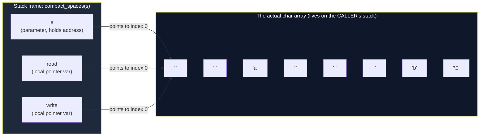
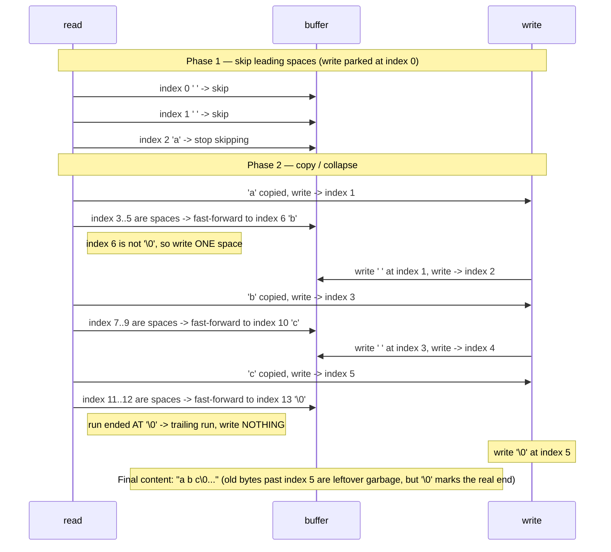

# Compact Spaces (Pointer Arithmetic)

**Date:** 2026-09-15
**Language:** C
**Source:** boot.dev
**Concepts:** pointer arithmetic, read/write cursors, in-place string mutation, stack memory, null termination

---

## 🎯 The Problem

Write the function `compact_spaces(char *s)` that modifies a C string **in place** using pointer arithmetic.

It should:
- Remove leading and trailing spaces.
- Replace any sequence of one or more spaces `' '` between words with a single space.
- Only treat the ASCII space character `' '` as a space (ignore tabs/newlines if present).

**Do not allocate new memory.** Work directly on the provided buffer using pointer arithmetic (moving read/write pointers). Remember that C arrays "decay" to pointers when passed to functions.

**Examples:**
- Input: `"  Launch the rockets!  "` → Output: `"Launch the rockets!"`
- Input: `"   "` → Output: `""` (empty string)
- Input: `"NoExtraSpaces"` → Output: `"NoExtraSpaces"`

**What to do (high level):**
1. Skip all leading spaces using a read pointer.
2. Copy characters from read to write pointer.
3. When you reach a space, skip all following spaces. If you're not at the beginning anymore and not at the end of the string, write exactly one space, then continue copying the next word.
4. Ensure the string is null-terminated at the end.

**Constraints:**
- Do not use `malloc` or any dynamic allocation.
- Do not call `strlen()` to determine length; process the string by scanning until `\0`.
- Only modify via pointer movement and assignments.

---

## 🧩 My Thought Process

This is the same read/write cursor family as `squeeze_spaces` from the "Filter With Pointers" task, but with one extra responsibility: `squeeze_spaces` only collapsed runs of spaces, while `compact_spaces` also has to **strip the leading run** before the write cursor ever starts, and **drop a trailing run** instead of writing it as a single space.

I split the function into two phases:

**Phase 1 — eat the leading spaces before `write` ever moves:**

```c
char *read = s;
char *write = s;  

while (*read == ' ') {
  read++;
}
```

`write` stays parked at `s` while `read` walks past every leading space. That's the trick that makes "leading spaces disappear" trivial — `write` simply never gets a chance to record them, because nothing has been written yet.

**Phase 2 — walk the rest of the string, collapsing runs and copying words:**

```c
while (*read != '\0') {
  if (*read == ' ') {
    while (*read == ' ') {
      read++;
    }
    if (*read != '\0') {
      *write = ' ';
      write++;
    }
  }
  else {
    *write = *read;
    write++;
    read++;
  }
}
```

Every time `read` lands on a space, I don't write a space immediately — I first fast-forward `read` through the *entire* run of spaces. Only then do I check: did that run end in the middle of the string, or did it run straight into `\0` (a trailing run)? If it's mid-string (`*read != '\0'`), exactly one space goes to `write`. If the run was actually the trailing spaces, `*read` is already `'\0'` and the inner `if` is skipped — so no space gets written, and the trailing run silently vanishes.

That single `if (*read != '\0')` check is doing double duty: it's what turns "a run of N spaces" into "exactly one space" for interior runs, and it's what turns "a run of N spaces that reaches the end" into "nothing at all" for a trailing run.

**Phase 3 — terminate:**

```c
*write = '\0';
```

Wherever `write` ended up after copying all the real content, that's where the new, shorter string ends.

Tracing it on `"  a   b   c  "`:
- Phase 1 skips the two leading spaces; `read` lands on `'a'`, `write` is still at index 0.
- `'a'` is copied, `write` advances to index 1.
- The 3-space run is collapsed to one space written at index 1, `write` → 2.
- `'b'` copied → `write` 3.
- The next 3-space run collapsed to one space → `write` 4.
- `'c'` copied → `write` 5.
- The final 2-space run runs straight into `'\0'`, so the inner `if` is false — no space written.
- `*write = '\0'` at index 5.
- Result: `"a b c"` — leading/trailing gone, interior runs collapsed to one space each.

---

## ✅ My Solution

```c
void compact_spaces(char *s) {
  char *read = s;
  char *write = s;  

  while (*read == ' ') {
    read++;
  }

  while (*read != '\0') {
    if (*read == ' ') {
      while (*read == ' ') {
        read++;
      }

      if (*read != '\0') {
        *write = ' ';
        write++;
      }
  }
  else {
    *write = *read;
    write++;
    read++;
    }

  }

  *write = '\0';
}
```

---

## 🖼️ Visualizing Pointers, the Stack, and the Algorithm

### 1. What a pointer actually is

A pointer is just a variable whose *value* is a memory address. `s`, `read`, and `write` are three separate pointer variables, but at the start of the function all three **hold the same address** — the address of the first character of the caller's buffer.



None of these three pointers *own* the characters — they just reference them. `*read` dereferences the address `read` currently holds to get the `char` stored there; `read++` doesn't move any data, it just makes the address `read` holds one byte larger.

### 2. Stack vs. heap — why this function never touches the heap

The task explicitly forbids `malloc`, and the reason that's possible here is that `compact_spaces` never needs a buffer of a *different* size — it only ever needs a buffer **no larger** than the one it was given, because compacting spaces can only shrink a string, never grow it.

```mermaid
flowchart TB
    subgraph Caller["Caller's stack frame"]
        arr["char buf1[] = \"  Launch   the   rockets!  \"\n(28 bytes, fixed size, lives until buf1 goes out of scope)"]
    end

    subgraph CSFrame["compact_spaces's stack frame"]
        sp["s --> points into buf1"]
        rp["read --> points into buf1"]
        wp["write --> points into buf1"]
    end

    subgraph Heap["Heap"]
        nothing["(nothing allocated —\nno malloc/free anywhere\nin this function)"]
    end

    arr -. "same memory, no copy made" .-> sp
    CSFrame -. "writes happen\nback into buf1 directly" .-> arr

    style Caller fill:#14532d,color:#fff
    style CSFrame fill:#1e293b,color:#fff
    style Heap fill:#450a0a,color:#fff,stroke-dasharray: 5 5
```

- **Stack:** `buf1` is a local array in the caller (or test function). It's allocated automatically when that function's frame is pushed, and freed automatically when the frame pops — no manual cleanup needed, but also no control over its lifetime beyond the function's scope.
- **Heap:** would be used if we called `malloc` to get a buffer whose size we only know at runtime and whose lifetime needs to outlive the current function. `compact_spaces` never needs that because it mutates the existing stack buffer in place and the result is always ≤ the input length.
- `s`, `read`, and `write` are themselves stack variables (they live in `compact_spaces`'s own frame), but the *data they point to* lives in the caller's frame. Pointers don't care which stack frame the memory is in — an address is an address.

### 3. Tracing the read/write cursors on `"  a   b   c  "`



The key moment in both diagrams is the same `if (*read != '\0')` check: it's the single branch point that decides whether a space-run was "between two words" (write one space) or "the trailing run" (write nothing).

---

## ✅ Verification

I wrote a small, dependency-free C test harness that reproduces every case from the pasted `munit` test file, using plain `CHECK_STR` macros instead of a test framework:

```c
#define CHECK_STR(actual, expected, msg)                                   \
    do {                                                                   \
        const char *check_str_actual_ = (actual);                         \
        tests_run++;                                                       \
        if (check_str_actual_ != NULL &&                                  \
            strcmp(check_str_actual_, (expected)) == 0) {                 \
            tests_passed++;                                                \
        } else {                                                           \
            printf("    FAIL: %s -- expected \"%s\", got \"%s\"\n",        \
                   msg, expected,                                         \
                   check_str_actual_ ? check_str_actual_ : "(null)");     \
        }                                                                  \
    } while (0)
```

(The `const char *check_str_actual_` local is a deliberate habit carried over from the Filter-With-Pointers task, where applying the null-check ternary directly to a fixed-size array argument triggered a `-Waddress` warning in my own harness. Assigning through a real pointer variable first avoids that class of warning entirely.)

Three test functions, covering all six assertions from the original `main()`:

```c
void test_compact_spaces_run_basic(void) {
    char buf1[] = "  Launch   the   rockets!  ";
    compact_spaces(buf1);
    CHECK_STR(buf1, "Launch the rockets!", "buf1 mismatch");

    char buf2[] = "NoExtraSpaces";
    compact_spaces(buf2);
    CHECK_STR(buf2, "NoExtraSpaces", "buf2 mismatch");

    char buf3[] = "";
    compact_spaces(buf3);
    CHECK_STR(buf3, "", "buf3 mismatch");
}

void test_compact_spaces_submit_edges(void) {
    char buf1[] = "     ";
    compact_spaces(buf1);
    CHECK_STR(buf1, "", "all spaces -> empty");

    char buf2[] = "  a   b   c  ";
    compact_spaces(buf2);
    CHECK_STR(buf2, "a b c", "a b c mismatch");
}

void test_compact_spaces_submit_happy_end(void) {
    char buf[] = "Hello,   world!   This  is   C. ";
    compact_spaces(buf);
    CHECK_STR(buf, "Hello, world! This is C.", "long sentence mismatch");
}
```

**Compiled and run twice** — a plain build, and a second build under AddressSanitizer + UndefinedBehaviorSanitizer to catch any out-of-bounds writes from the pointer arithmetic:

```bash
# Plain build
gcc -std=c99 -Wall -Wextra -o verify_plain exercise.c verify_compact_spaces.c
./verify_plain

# ASan + UBSan build
gcc -std=c99 -Wall -Wextra -fsanitize=address,undefined -g -o verify_asan exercise.c verify_compact_spaces.c
./verify_asan
```

**Real output (both builds identical):**

```
Running checks for compact_spaces

  test_compact_spaces_run_basic
  test_compact_spaces_submit_edges
  test_compact_spaces_submit_happy_end

6/6 checks passed
```

Zero compiler warnings on `exercise.c` under `-Wall -Wextra` in either build, and ASan/UBSan reported no out-of-bounds access, no use of uninitialized memory, and no undefined behavior — confirming the pointer arithmetic never reads or writes outside the buffer `s` points into, even on the empty-string and all-spaces edge cases.

---

## 🔍 Portions Worth Refactoring

1. **Stray brace indentation around the `if`/`else`.** The closing brace of the `if (*read == ' ')` block and the `else` are indented one level shallower than the rest of the function — purely cosmetic, doesn't affect behavior, but `clang-format` would flatten this instantly.

2. **The leading-space skip and the inner space-run skip are the same loop, written twice.** `while (*read == ' ') { read++; }` appears verbatim in Phase 1 and again inside the `if` branch of Phase 2. It would be reasonable to factor this into a tiny static helper:
   ```c
   static void skip_spaces(char **cursor) {
     while (**cursor == ' ') {
       (*cursor)++;
     }
   }
   ```
   I didn't change the submitted code — this is a style note, not a bug — but it's worth naming since it's the same "skip a run" idea appearing twice in one function.

3. **No performance concern.** The function is a single linear pass — `read` only ever moves forward, `write` only ever moves forward and never ahead of `read` — so this is O(n) time, O(1) extra space, which is the best possible for this problem.

---

## 💡 The Core Lesson

The entire function hinges on **deferring the decision**: when `read` hits a space, the code doesn't immediately decide "write a space" or "don't write a space." It first *finds out where the run of spaces ends* by fast-forwarding `read`, and only then asks "did that run end at `\0`, or somewhere in the middle of the string?" That one piece of lookahead is what lets a single loop correctly handle leading spaces (handled before the loop even starts), interior runs (collapsed to one space), and trailing runs (dropped) without needing three separate passes or `strlen()` to know in advance where the string ends.

---

## 📚 Lessons Learnt

1. **Separating the "skip leading" phase from the main loop removes a special case.** Rather than teaching the main loop to recognize "is this the very beginning of the string," I just let `read` run ahead of `write` before the main loop starts — so by the time the loop begins, "beginning of string" has already been handled and never needs checking again.

2. **A single `if (*read != '\0')` after fast-forwarding through a space-run cleanly distinguishes "interior run" from "trailing run."** This is the same branch, used for two different purposes, because a trailing run and an interior run look identical until you check what comes immediately after them.

3. **`write` is always ≤ `read`.** Every branch of the loop advances `read` by at least as much as it advances `write` (sometimes `read` advances past several characters while `write` advances by one, as with a collapsed space-run). That invariant is exactly what makes writing through `write` safe even though we're reading and writing into the *same* buffer — `write` can never catch up to and overwrite a character `read` hasn't looked at yet.

4. **In-place mutation needs no heap allocation when the output can never be longer than the input.** `compact_spaces` only ever removes characters, so the original buffer is always big enough to hold the result — this is why the task can forbid `malloc` entirely and still be solvable.

5. **A pointer is a value (an address), not a container.** `s`, `read`, and `write` all started out holding the exact same address; they diverge only because each one gets incremented independently. Seeing this clearly is what makes "two pointers into one array" click as a mental model, instead of feeling like three separate copies of data.

6. **ASan/UBSan is the right tool for verifying pointer-arithmetic-heavy code precisely because the bug class here (reading or writing one byte too far) is invisible in a normal run on well-behaved inputs but is exactly what sanitizers are built to catch.** Running the all-spaces and empty-string edge cases under ASan is what gives confidence beyond "the test output looked right."

7. **Writing a null terminator based on wherever `write` ends up — rather than computing a final length up front — is the natural consequence of using a write cursor at all.** The terminator placement falls out of the algorithm for free; there's no separate "now compute the new length" step.

---

## 🔗 Further Reading

- [cppreference — Pointer declaration and arithmetic](https://en.cppreference.com/w/c/language/pointer)
- [cppreference — the "erase-remove" idiom](https://en.cppreference.com/w/cpp/algorithm/remove) (the C++ STL's version of the same read/write cursor idea, generalized)
- [AddressSanitizer documentation](https://github.com/google/sanitizers/wiki/AddressSanitizer)
- **Suggested next exploration:** try rewriting `compact_spaces` to also treat tabs (`'\t'`) and newlines (`'\n'`) as whitespace, by replacing the single `*read == ' '` checks with a call to `isspace((unsigned char)*read)` from `<ctype.h>` — a good exercise in seeing how much of the pointer-cursor logic is untouched by changing *what counts* as the separator, versus how the cursors move.

---

**Repo path:** `c/2026-10-05-compact-spaces/`