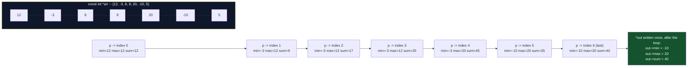
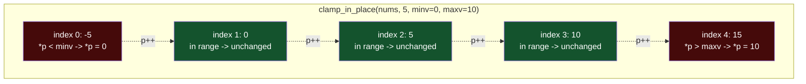
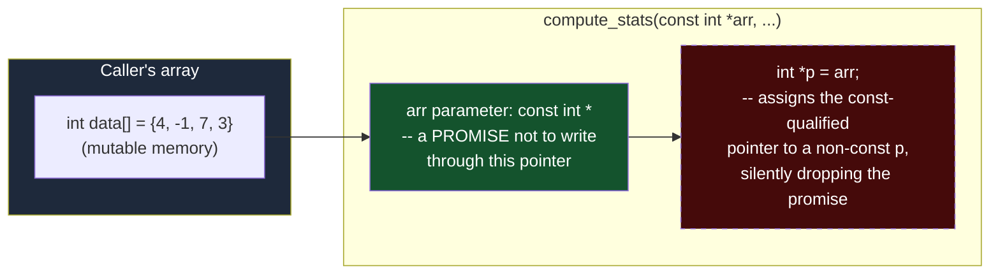

# Pointer Workshop: Array Stats and Clamping

**Date:** 2026-09-16
**Language:** C
**Source:** boot.dev
**Concepts:** pointer arithmetic over arrays, writing through a struct pointer, `const`-correctness, signed/unsigned comparison

---

## 🎯 The Problem

Complete two functions that practice pointer basics in C: working with arrays as pointers, and writing through pointers to structs. Both are implemented in `exercise.c`.

**1) `compute_stats`**

```c
int compute_stats(const int *arr, size_t len, stat_t *out);
```

- Use pointer arithmetic to walk the array and compute `min`, `max`, and `sum`.
- Write results into the `out` struct via the struct pointer.
- Return `1` (true) when `len > 0`.
- If `len == 0`: set `out->min = 0`, `out->max = 0`, `out->sum = 0`, and return `0`.

Example:
```c
int data[] = {4, -1, 7, 3};
stat_t s;
int ok = compute_stats(data, 4, &s);
// ok == 1
// s.min == -1, s.max == 7, s.sum == 13
```

**2) `clamp_in_place`**

```c
void clamp_in_place(int *arr, size_t len, int minv, int maxv);
```

- Modify the array in place using pointer arithmetic (no indexing required).
- For each element `x`: if `x < minv`, set it to `minv`; if `x > maxv`, set it to `maxv`; otherwise leave it unchanged.

Example:
```c
int nums[] = {-5, 0, 5, 10, 15};
clamp_in_place(nums, 5, 0, 10);
// nums is now: {0, 0, 5, 10, 10}
```

**Types:**
```c
typedef struct {
  int min;
  int max;
  int sum;
} stat_t;
```

**Notes:** don't allocate memory — work with the pointers given; keep the code in `exercise.c`; be careful with the empty-array case for `compute_stats`.

---

## 🧩 My Thought Process

Both functions share the same skeleton: grab a raw `int *` into the array, then walk it with pointer arithmetic (`p++`) instead of indexing (`arr[i]`), dereferencing `*p` to read or write the current element.

**`compute_stats`** — the empty-array case is handled first and separately, because `min`/`max` need to be seeded from the *first* element (`int min = *p; int max = *p;`), and there is no first element when `len == 0`. Once that guard is out of the way, a single forward pass does all three jobs at once: compare against `max`, compare against `min`, and accumulate into `sum`. All three results are written into `*out` through the struct pointer at the end — `out->min = min`, `out->max = max`, `out->sum = sum` — which is a different kind of pointer write than the `*p` walk: it's one dereference-and-assign into three separate fields of the struct that lives at `out`'s address, rather than a walk.

**`clamp_in_place`** — simpler, no result to accumulate. Walk the array once with the same `int *p = arr; ... p++` pattern, and for each element independently check "too low" then "too high," writing `*p = minv` or `*p = maxv` in place when a bound is violated. Because the two checks (`< minv`, `> maxv`) are mutually exclusive for any single element, there's no need for an `else` — testing both unconditionally is harmless and arguably clearer than chaining them.

While verifying this, actually compiling the code (not just reading it) turned up three real warnings in the submitted solution — none of them affect correctness for the given test cases, but they're worth documenting honestly since this is meant to be a log of what the code actually does, not just what it's intended to do. See **Portions Worth Refactoring** below.

---

## ✅ My Solution

```c
int compute_stats(const int *arr, size_t len, stat_t *out) {
  if (len == 0) {
    out->min = 0;
    out ->max = 0;
    out->sum = 0;
    return 0;
  }

  int sum = 0;
  int *p = arr;
  int min = *p;
  int max = *p;

  for (int i = 0; i < len; i++, p++) {
    if (*p > max) {
      max = *p;
    }
    if (*p < min) {
      min = *p;
    }
    sum += *p;
  }
  out->min = min;
  out->max = max;
  out->sum = sum;
  return 1;
}

void clamp_in_place(int *arr, size_t len, int minv, int maxv) {
  if (len == 0) {
    return;
  }

  int *p = arr;

  for (int i = 0; i < len; i++, p++) {
    if (*p < minv) {
      *p = minv;
    }

    if (*p > maxv) {
      *p = maxv;
    }
  }
}
```

---

## 🖼️ Visualizing the Pointer Walk

### 1. `compute_stats` — one pass, three running values, then one struct write



`min`, `max`, and `sum` are ordinary local `int` variables — they live in `compute_stats`'s own stack frame, not inside `*out`. The struct pointed to by `out` is only touched twice in the whole function: once in the empty-array branch, and once at the very end of the happy path. Everything in between is bookkeeping in locals.

### 2. `clamp_in_place` — writing back through the same pointer that read



There's no separate output buffer here — `*p = minv` and `*p = maxv` write directly back into the same memory `p` is currently reading from. That's what "in place" means: the caller's array (`nums` in the example) is mutated through the pointer the function was given, and nothing is copied or returned.

### 3. The `const int *` vs `int *` distinction, and where it breaks down in this code



`compute_stats` takes `const int *arr` specifically so that callers (and the compiler) can trust it will only *read* the array, never write to it. `int *p = arr;` immediately throws that guarantee away by binding a non-`const` pointer to the same address — the compiler flags this because, from that point on, nothing stops `*p = something` from compiling even though the function signature promised read-only access. (This particular function never actually writes through `p`, so the broken promise causes no real bug here — but the compiler can no longer enforce that it won't, which is exactly what `const` is for.)

---

## ✅ Verification

I wrote a dependency-free C test harness reproducing all four cases from the pasted `munit` test file, using `CHECK_INT` and a small `check_array_equal` helper built on it:

```c
static void check_array_equal(const int *got, const int *exp, size_t len,
                               const char *msg) {
    size_t i;
    for (i = 0; i < len; i++) {
        CHECK_INT(got[i], exp[i], msg);
    }
}
```

Four test functions, matching the four `munit_case` blocks:

```c
void test_compute_stats_run(void) {
    int data[] = {4, -1, 7, 3};
    stat_t s;
    int ok = compute_stats(data, 4, &s);
    CHECK_INT(ok, 1, "len=4 -> return 1");
    CHECK_INT(s.min, -1, "min should be -1");
    CHECK_INT(s.max, 7,  "max should be 7");
    CHECK_INT(s.sum, 13, "sum should be 13");
}
/* ...clamp_in_place_run, compute_stats_submit_edge_and_happy, clamp_in_place_submit... */
```

One small adaptation from the original: the pasted munit test used `int empty[] = {};`, a zero-size-array GCC extension that isn't valid standard C99. I used `int empty[1] = {0}` paired with `len = 0` instead — functionally identical for this test (the array's contents are never read when `len` is `0`), but portable across compilers without relying on a GNU extension.

**Compiled and run twice** — a plain build, and a second build under AddressSanitizer + UndefinedBehaviorSanitizer:

```bash
# Plain build
gcc -std=c99 -Wall -Wextra -o verify_plain exercise.c verify_stats_clamp.c
./verify_plain

# ASan + UBSan build
gcc -std=c99 -Wall -Wextra -fsanitize=address,undefined -g -o verify_asan exercise.c verify_stats_clamp.c
./verify_asan
```

**Real output (both builds identical, after the warnings below):**

```
Running checks for compute_stats / clamp_in_place

  test_compute_stats_run
  test_clamp_in_place_run
  test_compute_stats_submit_edge_and_happy
  test_clamp_in_place_submit

27/27 checks passed
```

All 27 assertions pass on both builds, and ASan/UBSan reported no out-of-bounds access and no undefined behavior. The code is functionally correct for every case in the test suite — but it is **not warning-clean**, which the next section covers.

---

## 🔍 Portions Worth Refactoring

Actually compiling `exercise.c` under `-Wall -Wextra` surfaces three real warnings. None of them cause a test to fail here, but all three are worth fixing in a second pass:

1. **`int *p = arr;` in `compute_stats` discards the `const` qualifier:**
   ```
   exercise.c:12:12: warning: initialization discards 'const' qualifier from pointer target type [-Wdiscarded-qualifiers]
      12 |   int *p = arr;
         |            ^~~
   ```
   `arr` is declared `const int *arr` — a promise that `compute_stats` won't modify the caller's array. Assigning it to a non-`const` `int *p` silently breaks that promise at the type level (even though this function never actually writes through `p`). The fix is one keyword: `const int *p = arr;`.

2. **Signed/unsigned comparison in the `compute_stats` loop:**
   ```
   exercise.c:16:21: warning: comparison of integer expressions of different signedness: 'int' and 'size_t' {aka 'long unsigned int'} [-Wsign-compare]
      16 |   for (int i = 0; i < len; i++, p++) {
   ```
   `i` is `int` (signed) but `len` is `size_t` (unsigned). The comparison `i < len` is well-defined for every value these tests exercise, but it's a recognized footgun: if `len` were ever `0` while using a *decrementing* loop pattern, or if `i` could somehow go negative, the implicit conversion of `i` to unsigned before comparing can produce surprising results. The straightforward fix is declaring `i` as `size_t` too: `for (size_t i = 0; i < len; i++, p++)`.

3. **The identical signed/unsigned warning repeats in `clamp_in_place`:**
   ```
   exercise.c:38:21: warning: comparison of integer expressions of different signedness: 'int' and 'size_t' {aka 'long unsigned int'} [-Wsign-compare]
   ```
   Same cause, same fix — `size_t i` instead of `int i`.

4. **Minor spacing inconsistency:** `out ->max = 0;` (with a space before `->`) on line 6, versus `out->min = 0;` and `out->sum = 0;` on the surrounding lines — purely cosmetic, but inconsistent within the same four-line block.

5. **No performance concern.** Both functions are a single O(n) pass with O(1) extra space — the minimum possible work for computing stats over an array or clamping it in place.

I verified the code exactly as submitted (warnings and all) rather than silently fixing it, since the task was to document the solution, not rewrite it — but the actual compiler output is reported here in full rather than asserting "this compiles cleanly" without checking.

---

## 💡 The Core Lesson

Pointer arithmetic (`p++`, `*p`) and array indexing (`arr[i]`) are two notations for the same underlying walk, but they don't *carry the same guarantees* automatically — `const` on a pointer parameter is a promise that only holds as long as every pointer derived from it stays `const` too. The moment a function assigns a `const`-qualified pointer into a non-`const` local (as `compute_stats` does here), the compiler can no longer enforce that promise, even if the function's actual behavior happens not to violate it.

---

## 📚 Lessons Learnt

1. **`const int *` on a parameter is a contract, not just documentation** — and that contract can be silently broken by an unqualified local pointer variable, which is exactly what `-Wdiscarded-qualifiers` exists to catch.

2. **`min` and `max` must be seeded from the array's first element, not from `0` or `INT_MIN`/`INT_MAX`.** Seeding from a sentinel value works for `sum` (identity element `0`) but not for `min`/`max`, because there's no sentinel that's guaranteed to be outside the range of every possible `int` array — the first real element is the only safe starting point, which is exactly why the empty-array case has to be handled *before* that seeding step.

3. **One pass can answer three questions at once.** `min`, `max`, and `sum` don't need three separate loops — each iteration updates all three running values independently, because none of them depend on the others' current state.

4. **Writing into a struct through an `out` pointer happens once, not per-element.** The accumulation happens in local variables during the walk; `*out` (via `out->min`, `out->max`, `out->sum`) is only touched at the moments the function actually needs to report a result — once in the empty case, once at the end of the happy path.

5. **`i < len` where `i` is `int` and `len` is `size_t` compiles and often "works," but it's still worth matching types.** The usual-arithmetic-conversion rules promote `i` to unsigned for the comparison; for small positive loop counts this is harmless, but it's a well-known source of bugs the moment a signed loop variable could go negative or a length-related computation underflows.

6. **"In place" means writing back through the same pointer used to read.** `clamp_in_place` never allocates a second buffer — `*p = minv` / `*p = maxv` overwrite the exact memory `*p` was just compared against, which is what makes the mutation visible to the caller without returning anything.

7. **Compiling with `-Wall -Wextra` is a cheap, mechanical way to catch exactly the two bug classes pointer-heavy C code is most prone to** — qualifier violations and signed/unsigned mismatches — neither of which `-std=c99` alone will flag without the warning flags enabled.

---

## 🔗 Further Reading

- [cppreference — `const` and pointers](https://en.cppreference.com/w/c/language/const)
- [cppreference — usual arithmetic conversions (why signed/unsigned comparisons behave the way they do)](https://en.cppreference.com/w/c/language/conversion)
- [GCC warning options reference — `-Wdiscarded-qualifiers` and `-Wsign-compare`](https://gcc.gnu.org/onlinedocs/gcc/Warning-Options.html)
- **Suggested next exploration:** rewrite both loops with `const int *p = arr;` / `size_t i` and recompile to confirm all three warnings disappear with zero behavior change — a quick, concrete way to see that these warnings really were purely about type discipline, not correctness, for this particular input set.

---

**Repo path:** `c/2026-10-10-pointer-workshop-stats-clamp/`